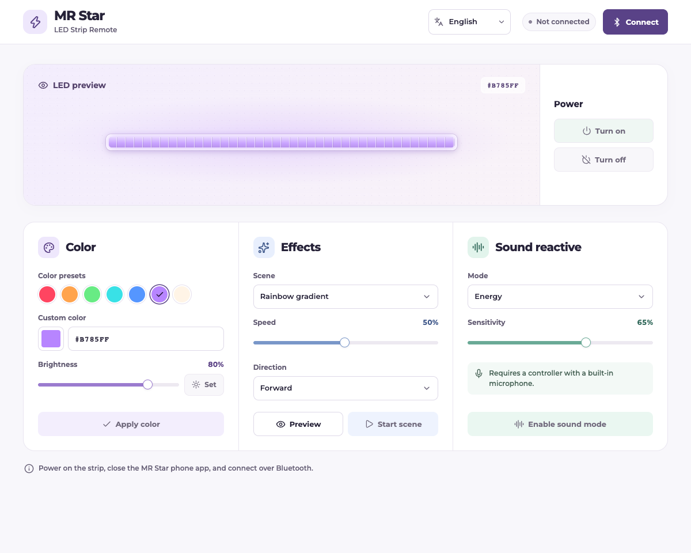

# MR Star Web Remote

Control Findn MR Star and Miracles Star LED strips directly from a browser over Bluetooth Low Energy. The remote includes power, color presets and custom HEX colors, brightness, animated previews, built-in scenes with speed and direction, and sound modes.



## Connect a strip

1. Open the remote in desktop Chrome or Edge on HTTPS or `localhost` and turn on Bluetooth.
2. Power on the strip and close the MR Star phone app to free the Bluetooth connection.
3. Click **Connect** and choose the controller. It may appear as `GATT--DEMO`, `MRSTAR`, or `MR Star`.

Color and scene previews also work before connecting. Sound modes require a controller with a built-in microphone. [Web Bluetooth browser support](https://developer.mozilla.org/en-US/docs/Web/API/Web_Bluetooth_API#browser_compatibility)

The remote opens in English by default. Use the language menu in the header to switch between English and Ukrainian. The browser remembers your choice.

## Run locally

Use Node.js 24 LTS and npm. Open the localhost URL printed by the development server.

```sh
npm ci
npm run dev
```

```sh
npm run build    # Build the static site into dist/
npm run preview  # Serve the production build locally
```

## Credits

- Bluetooth command format and scene IDs come from the MR-Star-OpenRGB project. [Protocol notes](https://github.com/witchbladeq/MR-Star-OpenRGB/blob/main/protocol.md) · [Scene catalog](https://github.com/witchbladeq/MR-Star-OpenRGB/blob/main/scenes.md)
- Montserrat is bundled under the SIL Open Font License 1.1. [Font license](public/fonts/OFL-Montserrat.txt)
- Interface icons are provided by Lucide. [Lucide](https://lucide.dev/) · [Icon license](public/licenses/lucide.txt)
